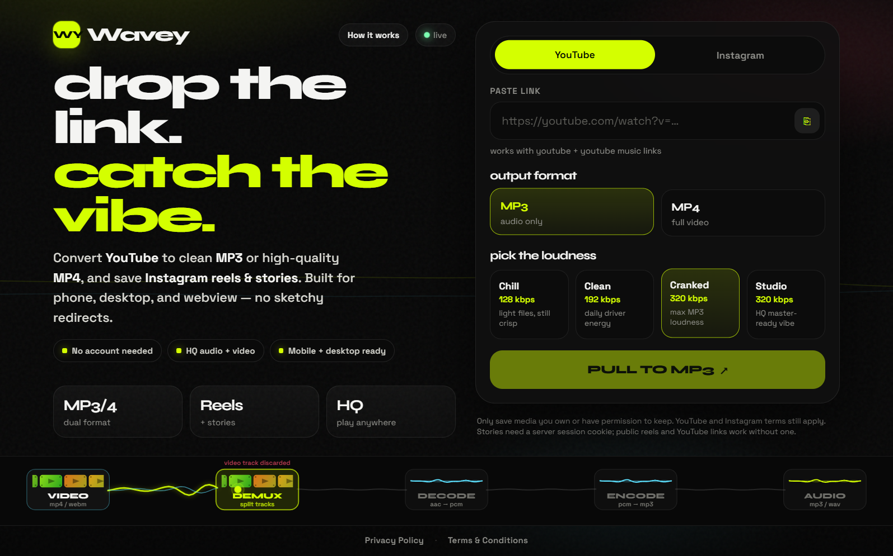

# Wavey

<p align="center">
  <strong>Drop a link. Catch the vibe.</strong><br />
  Convert YouTube to MP3 / MP4 and save public Instagram reels — fast UI, Vercel-ready API, no Docker.
</p>

<p align="center">
  <a href="LICENSE"></a>
  <a href="https://vitejs.dev/"></a>
  <a href="https://react.dev/"></a>
  <a href="https://vercel.com/"></a>
  <a href="https://www.typescriptlang.org/"></a>
</p>

<p align="center">
  <a href="#quick-start-local"></a>
  <a href="#deploy-to-vercel"></a>
  <a href="#important-notices"></a>
  <a href="LICENSE"></a>
</p>

---

## Preview



---

## Table of contents

1. [What is Wavey?](#what-is-wavey)
2. [Features](#features)
3. [Tech stack](#tech-stack)
4. [Prerequisites](#prerequisites)
5. [Quick start (local)](#quick-start-local)
6. [Environment variables](#environment-variables)
7. [How to use the app](#how-to-use-the-app)
8. [Project structure](#project-structure)
9. [API overview](#api-overview)
10. [Deploy to Vercel](#deploy-to-vercel)
11. [Troubleshooting](#troubleshooting)
12. [Important notices](#important-notices)
13. [Attributions](#attributions)
14. [Contributing](#contributing)
15. [License](#license)

---

## What is Wavey?

**Wavey** is an open-source media helper for personal use:

- Paste a **YouTube** URL → download **MP3** (browser-encoded) or **MP4**
- Paste a public **Instagram reel** URL → save as MP4 (or pull audio as MP3)
- **Stories** are optional and need a deployer-configured Instagram session cookie

The UI is a Vite + React SPA. The backend is Vercel Node serverless functions under `api/` (no Docker, no system `ffmpeg` / `yt-dlp` on the server). MP3 encoding happens in the browser with `ffmpeg.wasm`.

---

## Features

| Area | What you get |
| --- | --- |
| YouTube | Public watch / Shorts / Music links → MP3 bitrate tiers or MP4 resolution |
| Instagram | Public reels (best-effort); stories when `IG_SESSIONID` is set |
| Player | In-app audio / video preview, download, and Web Share when available |
| Security | HMAC-signed short-lived stream tokens; host allowlists; basic rate limits |
| Deploy | Static Vite build + `/api/*` on Vercel Fluid Compute |

---

## Tech stack

- **Frontend:** React 19, React Router, Framer Motion, Vite 8
- **API:** Vercel Serverless Functions (`api/`), TypeScript
- **YouTube:** [youtubei.js](https://github.com/LuanRT/YouTube.js) (Innertube client)
- **MP3 encode:** [@ffmpeg/ffmpeg](https://github.com/ffmpegwasm/ffmpeg.wasm) in the browser
- **Hosting target:** [Vercel](https://vercel.com/) (no Docker)

---

## Prerequisites

Install these before running locally:

| Tool | Version | Notes |
| --- | --- | --- |
| [Node.js](https://nodejs.org/) | **20+** (LTS recommended) | Includes `npm` |
| [Git](https://git-scm.com/) | Any recent | Clone / push |
| [Vercel CLI](https://vercel.com/docs/cli) | Latest | Required for full local API (`npm run dev:full`) |

Optional:

- A [Vercel](https://vercel.com/) account (deploy + `vercel dev` login)
- Instagram session cookie only if you need **stories**

---

## Quick start (local)

Follow these steps in order.

### 1. Clone the repository

```bash
git clone https://github.com/nuthanm/wavey.git
cd wavey
```

### 2. Install dependencies

```bash
npm install
```

### 3. Create your local env file

```bash
# Windows (PowerShell)
Copy-Item .env.example .env.local

# macOS / Linux
cp .env.example .env.local
```

Open `.env.local` and set at least:

```env
WAVEY_TOKEN_SECRET=replace-with-a-long-random-string
```

Generate a secret (example):

```bash
node -e "console.log(require('crypto').randomBytes(32).toString('hex'))"
```

> `.env.local` is gitignored. Never commit secrets.

### 4. Run the full stack (UI + API)

```bash
npm run dev:full
```

This runs `vercel dev`, which serves the Vite app **and** `/api/resolve`, `/api/stream`, `/api/health`.

Open the URL printed in the terminal (often `http://localhost:3000`).

### 5. UI-only mode (optional)

If you only need the frontend while iterating on styles:

```bash
npm run dev
```

Vite usually starts at `http://localhost:5173`. API calls proxy to `http://127.0.0.1:3000` — so keep `npm run dev:full` (or another API on 3000) running if you want resolve/download to work.

### 6. Production build check

```bash
npm run build
npm run preview
```

---

## Environment variables

| Variable | Required | Description |
| --- | --- | --- |
| `WAVEY_TOKEN_SECRET` | **Yes** (production) | HMAC secret for short-lived download tokens |
| `YT_COOKIE` | No | Browser cookie string if YouTube blocks anonymous Innertube access |
| `IG_SESSIONID` | No | Enables Instagram **stories** for the deployer |
| `IG_DS_USER_ID` | No | Often paired with `IG_SESSIONID` |
| `IG_CSRFTOKEN` | No | Often paired with `IG_SESSIONID` |

Template: [`.env.example`](.env.example)

On Vercel: **Project → Settings → Environment Variables** (set for Production and Preview).

---

## How to use the app

1. Open the running app in your browser.
2. Choose **YouTube** or **Instagram**.
3. Paste a link (or use the paste button).
4. Pick **MP3** or **MP4** (and bitrate / resolution for YouTube).
5. Tap **PULL TO MP3** / **PULL TO MP4** / **SAVE THE REEL**.
6. Preview in the player, then **Download** or **Share**.

**Expect honest limits:**

- Public YouTube videos work best; age-gated / region-blocked items may need `YT_COOKIE`.
- Instagram **public reels** only (without login).
- Stories need `IG_SESSIONID` and can expire or fail if private.
- Instagram hosts one rendered file — effects/captions are baked in as posted.

---

## Project structure

```text
wavey/
├── api/                 # Vercel serverless API
│   ├── resolve.ts       # POST — metadata + signed token
│   ├── stream.ts        # GET  — proxied media stream
│   ├── health.ts        # GET  — health / config flags
│   └── _lib/            # youtube, instagram, tokens, validation
├── src/                 # React SPA
│   ├── pages/           # Home, How it works
│   ├── components/      # UI chrome, player visuals, legal modal
│   └── lib/             # api client, ffmpeg encode, legal copy
├── docs/screenshots/    # README preview images
├── public/              # Static assets
├── vercel.json          # Build + SPA rewrites + function limits
├── .env.example         # Env template
├── LICENSE              # MIT
└── README.md
```

---

## API overview

| Method | Path | Purpose |
| --- | --- | --- |
| `POST` | `/api/resolve` | Body: `{ url, output: "mp3"\|"mp4", quality }` → metadata + `token` |
| `GET` | `/api/stream?token=…` | Streams media bytes for that token |
| `GET` | `/api/health` | Liveness + whether optional cookies are configured |

Tokens expire quickly (default ~10 minutes). Do not treat them as permanent download links.

---

## Deploy to Vercel

### Option A — CLI

```bash
npx vercel login
npx vercel          # link project / preview deploy
npx vercel env add WAVEY_TOKEN_SECRET
npx vercel --prod
```

### Option B — Dashboard

1. Push this repo to GitHub (already done if you cloned from here).
2. [Import the project](https://vercel.com/new) on Vercel.
3. Framework preset: **Vite** (or leave auto-detect).
4. Add environment variables from the table above.
5. Deploy.

Build output: `dist/`. API routes deploy from `api/`.

---

## Troubleshooting

| Symptom | What to try |
| --- | --- |
| `/api/resolve` → connection refused on Vite `:5173` | Start `npm run dev:full` (API on `:3000`) or only use the `vercel dev` URL |
| `WAVEY_TOKEN_SECRET is not configured` | Set the secret in `.env.local` (local) or Vercel env (prod) |
| YouTube “not playable” / empty formats | Video may be private, age-gated, or region-locked; try `YT_COOKIE` |
| Instagram reel fails | Confirm the reel is **public**; private / login-walled posts will not resolve |
| Stories fail | Set a fresh `IG_SESSIONID` (and related cookies); stories expire quickly |
| MP3 encode stuck | First encode downloads ffmpeg.wasm from the CDN — wait, or check network blockers |
| Vercel timeout on long 4K | Prefer 720p/1080p; stream function max duration is configured in `vercel.json` |

---

## Important notices

> **Wavey is an independent open-source project.**  
> It is **not** affiliated with, endorsed by, sponsored by, or partnered with Google LLC, YouTube, Meta Platforms, Inc., Instagram, or any of their subsidiaries.

**Responsible use**

- Only download or convert media you **own** or have **explicit permission** to keep.
- Respect copyright law and each platform’s Terms of Service.
- Do not use Wavey to infringe intellectual property, bypass paywalls, or access private content without authorization.
- Redistribution of third-party content may be illegal — you are solely responsible for your use of this software.

**Software warranty**

- Provided **“as is”** under the [MIT License](LICENSE), without warranty of any kind.
- Platform APIs and page layouts change often; extractors may break without notice.

Privacy and terms shown in the app: see in-app **Privacy Policy** and **Terms & Conditions**.

---

## Attributions

Wavey builds on excellent open-source work:

| Project | Role | License (upstream) |
| --- | --- | --- |
| [youtubei.js](https://github.com/LuanRT/YouTube.js) | YouTube Innertube client | See upstream repo |
| [ffmpeg.wasm](https://github.com/ffmpegwasm/ffmpeg.wasm) | In-browser MP3 encoding | See upstream repo |
| [Vite](https://vitejs.dev/) / [React](https://react.dev/) / [Framer Motion](https://www.framer.com/motion/) | App foundation | See upstream repos |
| [Vercel](https://vercel.com/) | Serverless hosting model | Commercial platform |

Product names and logos for YouTube, Instagram, Google, and Meta are trademarks of their respective owners. Used here only for descriptive interoperability.

---

## Contributing

Issues and pull requests are welcome.

1. Fork the repo and create a feature branch.
2. Keep changes focused; match existing TypeScript / UI style.
3. Run `npm run build` and `npm run lint` before opening a PR.
4. Do not commit `.env.local`, cookies, or personal credentials.

If you find a security-sensitive issue (token secret leakage, open proxy abuse), please report privately instead of filing a public issue with exploit details.

---

## License

This project is released under the [MIT License](LICENSE).

```text
Copyright (c) 2026 Wavey contributors
```

You may use, copy, modify, merge, publish, distribute, sublicense, and/or sell copies of the Software, subject to the license terms — including keeping the copyright and permission notice.

---

<p align="center">
  Made for personal, lawful media workflows.<br />
  <a href="#wavey">Back to top</a>
</p>
